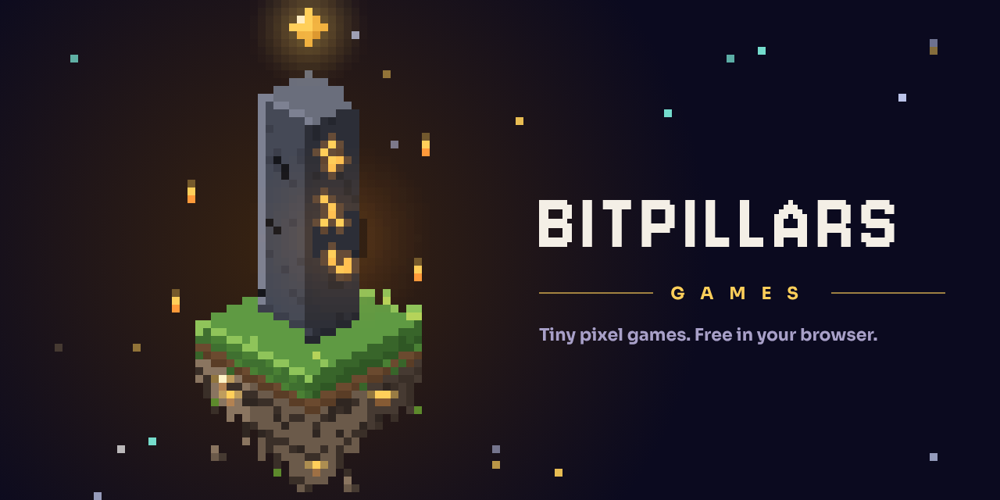
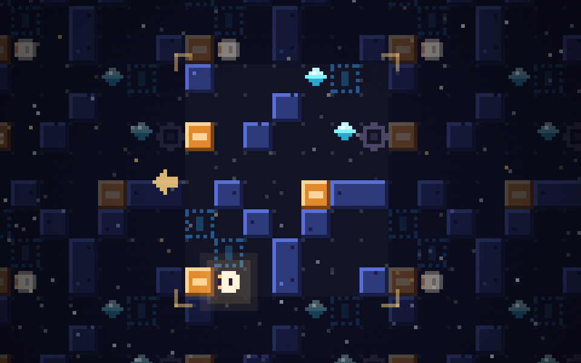
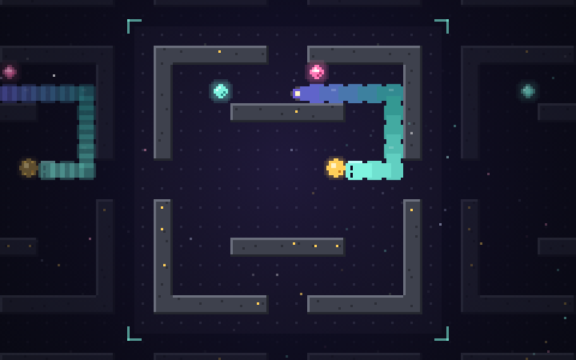
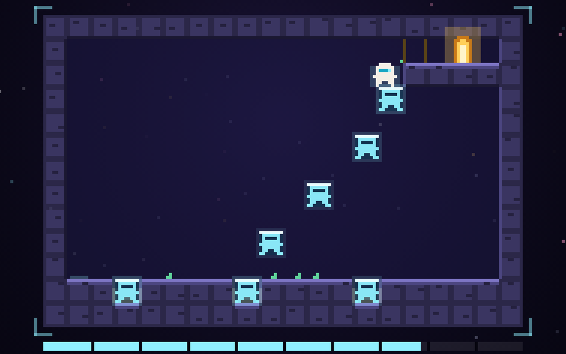
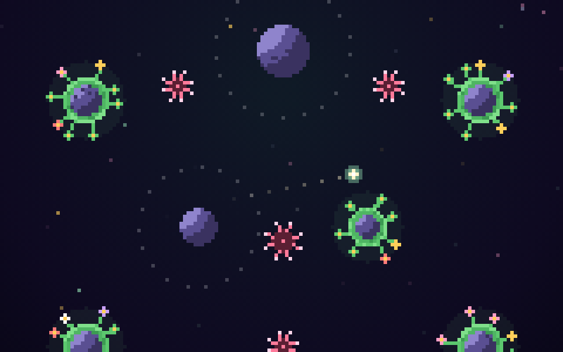
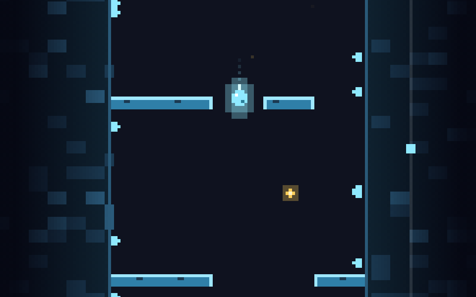
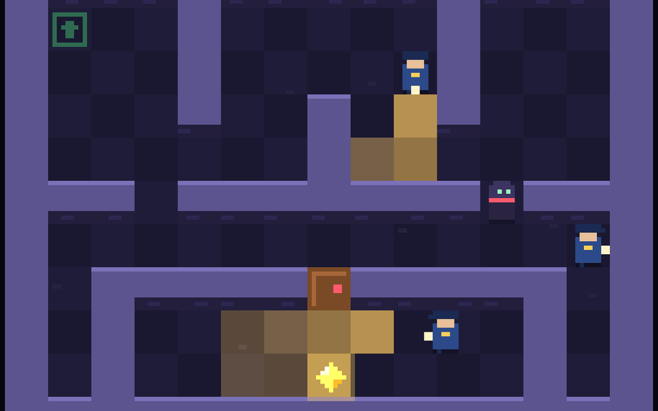
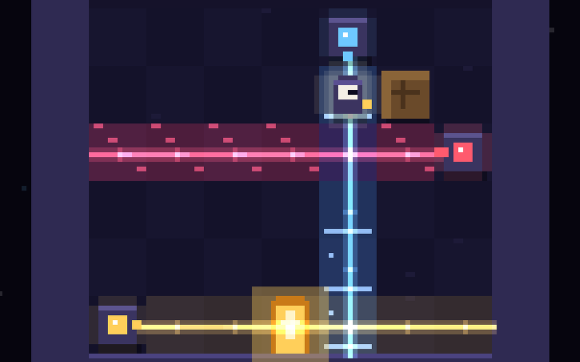

# BitPillars



Tiny pixel games, built for fun and free to play in your browser, on a phone or a desktop. No installs, no ads, no accounts.

**[▶ Open BitPillars](https://krupakarsb.github.io/bitpillars/)**

## Games

| Game | Genre | Play | Source |
|---|---|---|---|
| **LOOPFALL**: a gravity puzzle in a world that repeats forever | Puzzle | [Play](https://krupakarsb.github.io/bitpillars/loopfall/) | [`loopfall/`](loopfall/) |
| **OUROBOROS**: a fast, chill snake in a world without edges | Arcade | [Play](https://krupakarsb.github.io/bitpillars/ouroboros/) | [`ouroboros/`](ouroboros/) |
| **ECHO**: ten-second rooms where every life you lose becomes a platform | Platformer | [Play](https://krupakarsb.github.io/bitpillars/echo/) | [`echo/`](echo/) |
| **SLINGSHOT GARDEN**: orbit, let go, and make every planet bloom | One tap | [Play](https://krupakarsb.github.io/bitpillars/slingshot/) | [`slingshot/`](slingshot/) |
| **DRIP**: a drop of light, one long fall, swipe through the gaps | Arcade | [Play](https://krupakarsb.github.io/bitpillars/drip/) | [`drip/`](drip/) |
| **ONE MINUTE HEIST**: one room, one minute, one gem, and the room resets every minute | Stealth | [Play](https://krupakarsb.github.io/bitpillars/heist/) | [`heist/`](heist/) |
| **LUMEN**: light makes the rules: red stops you, blue is ice, gold opens the door | Puzzle | [Play](https://krupakarsb.github.io/bitpillars/lumen/) | [`lumen/`](lumen/) |

<p>
  
  
  
  
  
  
  
</p>

## Layout

```
index.html        landing page: game orbs above the pillar, live pixel night sky
brand/            logo, profile pictures, favicons, banner, splash
loopfall/         one folder per game, each with its own README and built index.html
ouroboros/
echo/
slingshot/
drip/
heist/
lumen/
```

Every game folder ships a built `index.html`, so GitHub Pages serves it at `krupakarsb.github.io/bitpillars/<folder>/` with no build step.

## Adding a game

1. Create a folder such as `my-game/` with an `index.html`, a `README.md` and a `docs/thumb.png` (16:10).
2. Add an entry to the `GAMES` list at the top of the script in the root `index.html`. It appears as a new orb in the carousel. Also add a link to the hidden `.sr` list.
3. Add a row to the table above.

## Brand

Logo, profile pictures, favicons, banner and splash screen live in [`brand/`](brand/). The wordmark is set in Jersey 10 (SIL Open Font License).

## Contact

bitpillars@gmail.com

## License

[MIT](LICENSE)
