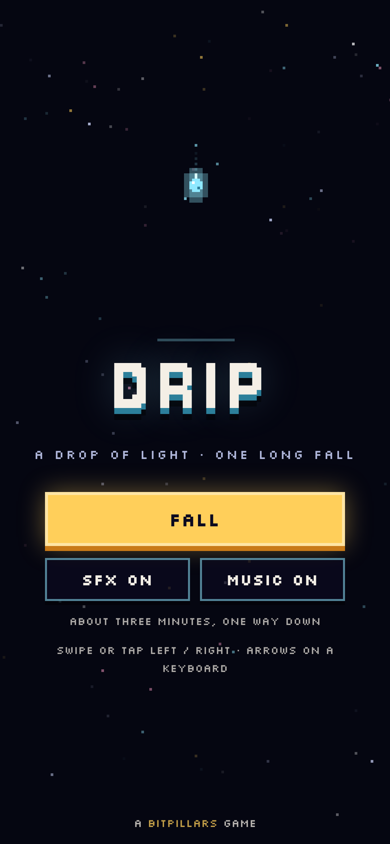
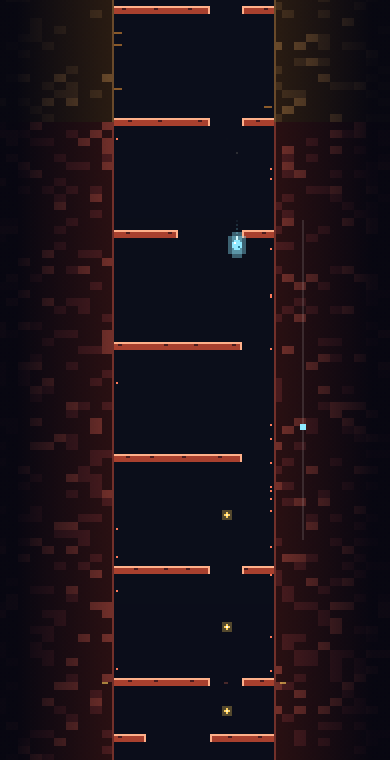

# DRIP

A drop of light falls down a deep shaft. Swipe left and right to slip through the gaps in each gate.
One run is about three minutes: through moss, crystal, roots, embers and the abyss, all the way to the bottom.
And then a little further.

**[▶ Play in your browser](https://krupakarsb.github.io/bitpillars/drip/)**: swipe or tap left/right on a phone, arrow keys on a desktop.

<p>
  
  
</p>

## How to play

| Thing | What it does |
|---|---|
| Gates | Bars across the shaft. Fall through a gap |
| Glow | You have three. Hitting a bar costs one |
| Pools | Gold marks on the walls are checkpoints. Lose all your glow and you start again from the last one |
| Motes | Little gold lights. Some sit off the safe line, so grabbing them is a small risk |

The shaft is the same for everyone, so you can learn it and chase a cleaner, faster run.

**Controls:** swipe or tap the left/right half of the screen, or press ← → / A D · `Esc` pause.

## How it works

- **Engine** (`src/engine.js`): pure logic with no DOM, shared by the browser and Node. Fixed 60 Hz steps, five lanes, and a seeded shaft of 150 gates in five layers. Speed rises as you go deeper.
- **Fair by construction:** every gate is generated around a safe line that never asks for more lane changes than you have time for at top speed, including in the tight double gates.
- **Bot** (`test/bot.js`): checks those timing limits, then plays the entire run (every phase, start to finish) through the real engine without a single hit. The browser test replays its inputs in the built game.
- **Fuzzer** (`test/fuzz.js`): a million frames of random swiping. The drop never leaves the shaft and the glow never breaks.
- **Audio:** every sound and the soundtrack are synthesized with the Web Audio API. No asset files.
- The game ships as one self-contained `index.html`.

## Build and test

```
python3 tools/build.py
node test/bot.js
node test/fuzz.js
```

Part of [BitPillars](https://krupakarsb.github.io/bitpillars/). MIT licensed.
