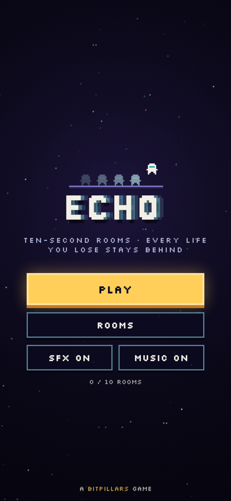
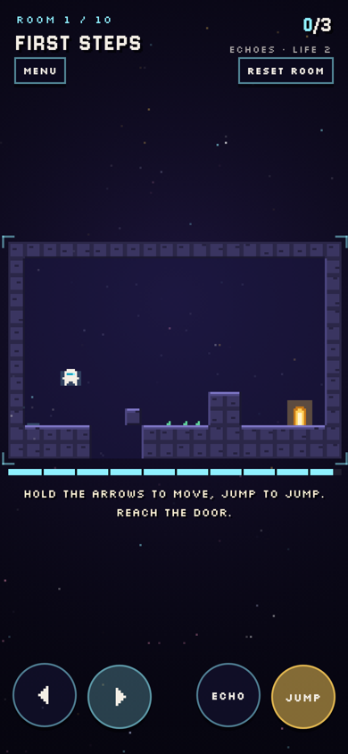
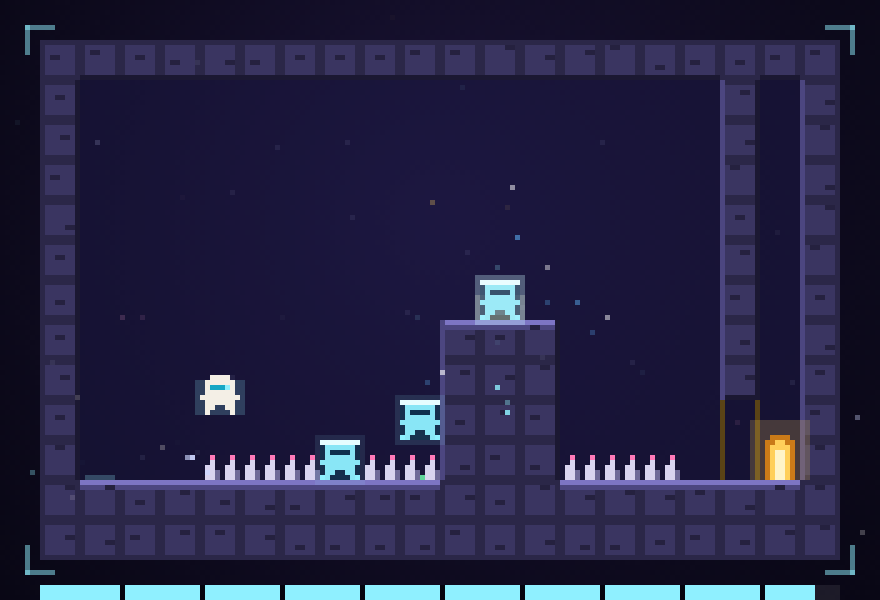

# ECHO

A small pixel platformer made of ten-second rooms.
Every life you lose stays behind as a frozen echo that you can stand on. A room you can't climb becomes a staircase made of your old attempts.
Ten rooms, about ten minutes. Plan your deaths.

**[▶ Play in your browser](https://krupakarsb.github.io/bitpillars/echo/)**: works on phones (on-screen buttons) and desktop (keyboard).

<p>
  
  
  
</p>

## How to play

| Thing | What it does |
|---|---|
| Ten seconds | Each life lasts ten seconds. When time runs out you freeze where you are |
| Echo | Press Down / ECHO to freeze on purpose. Echoes are solid, and they don't fall |
| Spikes | End a life, but your echo covers the spike that got you |
| Gold plate | Holds the gate open while something stands on it, like an echo |
| Echo limit | Each room keeps only so many echoes. When you go over, the oldest one fades |

**Controls:** arrows or A/D to move · Up / W / Space to jump · Down / S / X to leave an echo · `R` reset the room · `Esc` pause.
On a phone: ◀ ▶ on the left, ECHO and JUMP on the right.

## How it works

- **Engine** (`src/engine.js`): pure logic with no DOM, shared by the browser and Node. Fixed 60 Hz steps with coyote time, jump buffering and variable jump height. Echoes snap to the tile grid, and gates never close on top of you.
- **Solver** (`test/solver.js`): a breadth-first search over every frame-by-frame input for one life. It finds every cell you could freeze in, every spike you could land on, and whether the door is reachable. It also returns the exact inputs for any of them.
- **Bot** (`test/bot.js`): plays all ten rooms through the real engine using the solver's inputs and saves them. The browser test replays those inputs in the built game. It also checks that the last room can't be done with fewer echoes than it needs.
- **Fuzzer** (`test/fuzz.js`): about 1.7 million random frames across every room. The player never ends a frame inside a wall, values stay finite, and the echo limit is never broken.
- **Audio:** every sound and the soft soundtrack are synthesized with the Web Audio API. No asset files.
- The game ships as one self-contained `index.html`. Progress is saved in `localStorage`.

## Project layout

```
index.html                built game (served at /bitpillars/echo/)
src/engine.js             physics, echoes, rooms
src/game.template.html    rendering, UI, audio, input
tools/build.py            inlines the engine into the template -> index.html
test/solver.js            frame-by-frame BFS over one life
test/plan.js, bot.js      plays every room and records the inputs
test/fuzz.js              random-input fuzzer and invariant checks
docs/                     screenshots and the 16:10 thumbnail used on the BitPillars page
```

## Build and test

```
python3 tools/build.py
node test/bot.js
node test/fuzz.js
```

Part of [BitPillars](https://krupakarsb.github.io/bitpillars/). MIT licensed.
