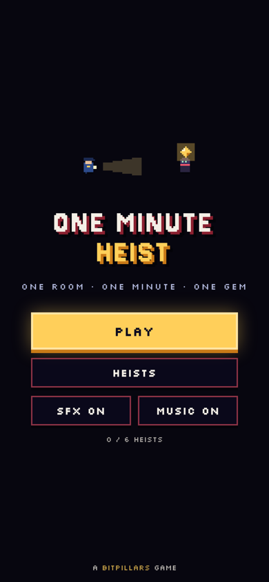
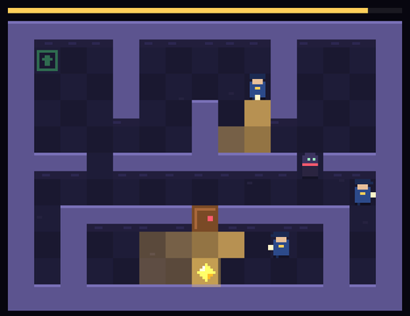

# ONE MINUTE HEIST

One room, one minute, one gem.
Sneak past the guards' flashlights, take the gem and get back out the way you came in. If you get seen, or the minute runs out, time rewinds and the room resets. You keep only what you learned, plus a trail of footprints from your last try.
Six jobs, short and sharp. The last one is personal.

**[▶ Play in your browser](https://krupakarsb.github.io/bitpillars/heist/)**: on-screen pad on a phone, arrow keys on a desktop.

<p>
  
  
</p>

## How to play

| Thing | What it does |
|---|---|
| Flashlights | A guard sees everything in their light. Walls and closed doors block it |
| Keycard | Opens locked doors until the minute ends |
| Lever | Opens the blue gate for ten seconds |
| Gold plate | Holds the gold bars open while someone stands on it |
| End minute | Rewind right now and start the minute again |

The world moves in steady ticks, six a second, so guards always walk the same routes. Watch them, learn the rhythm, then go.

**Controls:** arrows / WASD to move · Space to wait a tick · `R` end the minute · `Esc` pause.

## How it works

- **Engine** (`src/engine.js`): pure logic with no DOM, shared by the browser and Node. Every guard's route is worked out for the whole minute in advance. A flashlight is a short cone that walls and closed doors stop. Walking straight through a guard counts as being seen.
- **Solver** (`test/solver.js`): a tick-by-tick breadth-first search through the minute that finds the fastest clean heist. It also checks that the plain shortest walk gets caught, so the guards really matter.
- **Bot** (`test/bot.js`): plays every job through the real engine, including the last one, which takes more than one minute. The browser test replays its moves in the built game.
- **Fuzzer** (`test/fuzz.js`): over 200,000 ticks of random moves across many minutes. Nobody ever walks through a wall and the clock never breaks.
- **Audio:** every sound and the soundtrack are synthesized with the Web Audio API. No asset files.
- The game ships as one self-contained `index.html`.

## Build and test

```
python3 tools/build.py
node test/check.js
node test/bot.js
node test/fuzz.js
```

Part of [BitPillars](https://krupakarsb.github.io/bitpillars/). MIT licensed.
