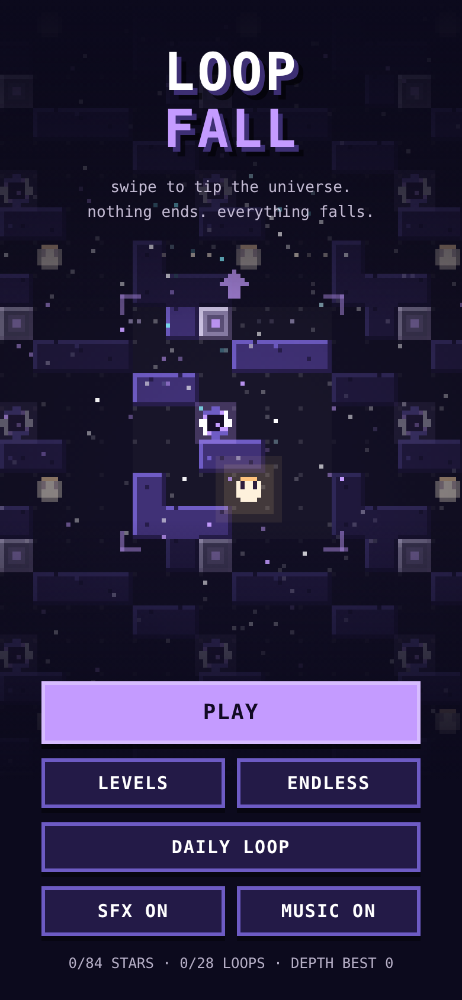
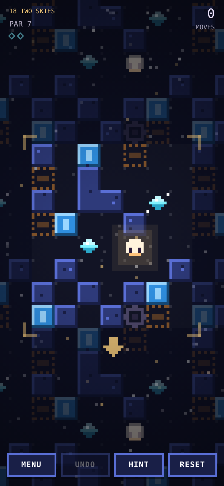
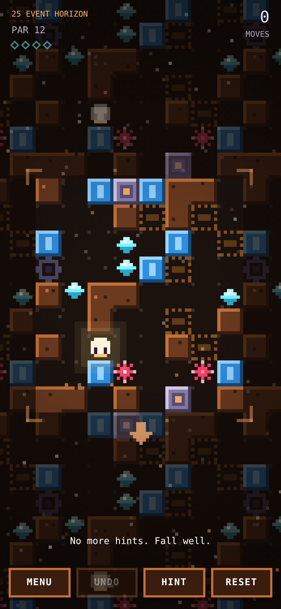

# LOOPFALL

A pixel-art gravity puzzle set in a world that repeats forever.
Swipe to tilt the whole universe: you, the stones, everything slides until something stops it.
Fall off one edge and you come back in from the other. Fall down a lane with nothing to catch you and you're lost in the loop.

**[▶ Play in your browser](https://krupakarsb.github.io/bitpillars/loopfall/)** — works on phones (swipe) and desktop (arrow keys / WASD).

<p>
  
  
  
</p>

## How to play

| Piece | What it does |
|---|---|
| You | Slides with gravity until blocked |
| ◆ Shard | Collect all of them to wake the gate |
| ■ Stone | Falls with gravity too. Use it as a platform |
| ✶ Thorn | Shatters you if you fall through it |
| Blue block | Solid only when gravity is up/down |
| Amber block | Solid only when gravity is sideways |

Beat a level in par moves (the provably shortest solution) for 3 stars.

**Controls:** swipe or arrow keys / WASD · `Z` undo · `R` restart · `H` hint · `Esc` menu

## Modes

- **Campaign:** 28 levels, introducing one mechanic at a time
- **Endless:** procedurally generated rooms that get harder the deeper you go
- **Daily Loop:** one generated room per day, the same for every player

## How it works

- **Wraparound simulation** (`src/engine.js`): all movable objects fall simultaneously, tick by tick, on a toroidal grid. An object still moving after two full laps of its lane is caught in an endless loop.
- **Solver:** breadth-first search over (player position, stone positions, collected-shard bitmask) states. It gives every level an exact par, powers the in-game hint button, and validates generated levels.
- **Generator:** seeded random rooms (mulberry32) are kept only if they are solvable, fall inside a target move range, require wrapping around an edge, and actually need their stones / phase blocks (checked by removing them and re-solving).
- **Rendering:** a low-resolution canvas scaled up with integer nearest-neighbour scaling. The level is drawn as an infinite tiled field whose copies fade with distance.
- **Audio:** all sound effects and the generative chiptune soundtrack are synthesized live with the Web Audio API. There are no asset files.
- No frameworks and no build dependencies: the game ships as one self-contained `index.html`.

## Project layout

```
index.html                  built game (served at /bitpillars/loopfall/)
src/engine.js               simulation, solver, generator (shared by browser + Node)
src/game.template.html      rendering, UI, audio, input
tools/build.py              inlines engine + levels into index.html
tools/curate.js             generates and verifies the campaign levels
tools/generated-levels.json curated level data
```

From this folder — rebuild: `python3 tools/build.py` · regenerate levels: `node tools/curate.js`

## License

MIT, see the [repository license](../LICENSE).

← Back to [BitPillars](../)
