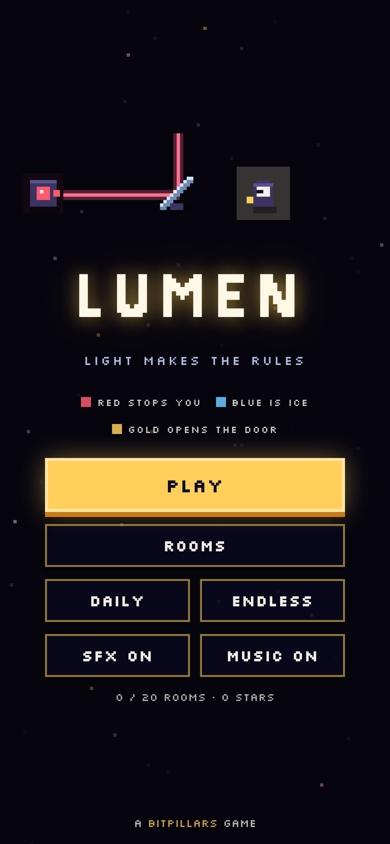
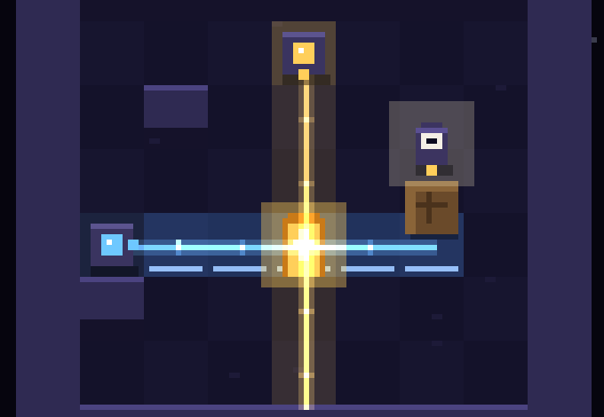

# LUMEN

A pixel puzzle game where light makes the rules.

- **Red light** stops you. That floor is solid, though things can still be pushed through it.
- **Blue light** is ice. You slide until something stops you.
- **Red and blue together** cancel out, and the floor is plain floor again.
- **Gold light** wakes the door. Step onto a lit door to leave.

You push lamps, mirrors and crates to move the light around, and the room's rules change as you do.
There are 20 rooms, a Daily room and an Endless run. In the last room, the lamps are gone.

**[▶ Play in your browser](https://krupakarsb.github.io/bitpillars/lumen/)**: swipe on a phone, arrow keys on a desktop.

<p>
  
  
</p>

## How to play

| Thing | What it does |
|---|---|
| Lamp | Shines one colour in one direction. Push it to move the beam |
| Mirror | Bends any beam that hits it. Push it into place |
| Crate | Blocks light. Push it into a beam to cast a shadow |
| Door | Opens while gold light falls on it |

Every room has a par: the fewest moves possible, found by the solver. Hit par for three stars.

**Controls:** swipe or arrows / WASD · `Z` undo · `R` restart · `H` hint · `Esc` menu.

## Procedurally generated, and checked

Most rooms come from a seeded generator. A room is kept only if it passes every check:

- The solver can finish it, in a move count inside the target range for its tier.
- The door starts dark.
- Every lamp, mirror and crate matters: take one away and the room has to change (it becomes impossible, easier or harder). Decoration is thrown out.

The tiers introduce one idea at a time: gold only, then red, then mirrors, then blue, then everything together.
Between them sit five short hand-made rooms that teach each rule, plus the finale.
The rooms that aren't in the campaign make up the Daily and Endless pool.

## How it works

- **Engine** (`src/engine.js`): pure logic with no DOM, shared by the browser and Node.
  - It traces each beam tile by tile, with mirror reflections, and works out every tile's colour mix.
  - Moves are turn-based and deterministic.
  - It also contains the breadth-first solver, used for par, for the in-game hint, and to check generated rooms.
- **Generator** (`tools/curate.js`): makes and filters rooms for one tier and writes them to `gen/`. `tools/assemble.js` builds the campaign and the pool into `src/rooms.json`.
- **Tests:**
  - `test/bot.js` replays every room's solution through the real engine and checks that each par really is the minimum.
  - `test/fuzz.js` makes about 500,000 random moves. You never walk into red light, nothing overlaps and nothing leaves the room.
  - The browser test plays all 20 rooms in the built game.
- **Audio:** every sound and the soundtrack are synthesized with the Web Audio API. No asset files.
- The game ships as one self-contained `index.html`.

## Build and test

```
node tools/curate.js <tier> <count> <minPar> <maxPar> <seed> gen/t<tier>.json   # optional: make more rooms
node tools/assemble.js                                                            # rooms -> src/rooms.json
python3 tools/build.py                                                            # -> index.html
node test/bot.js && node test/fuzz.js
```

Part of [BitPillars](https://krupakarsb.github.io/bitpillars/). MIT licensed.
