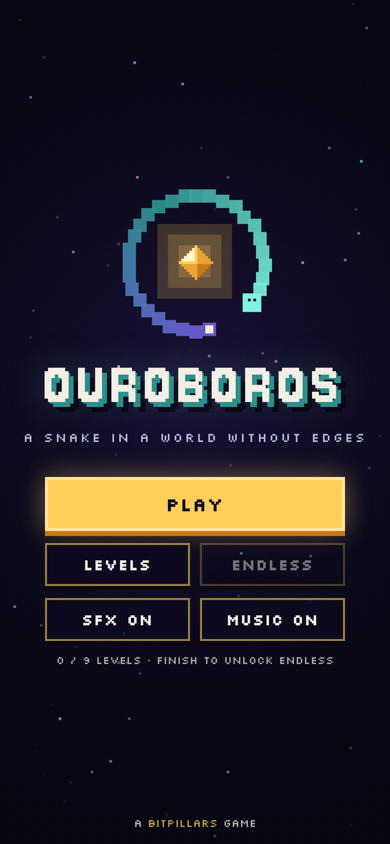
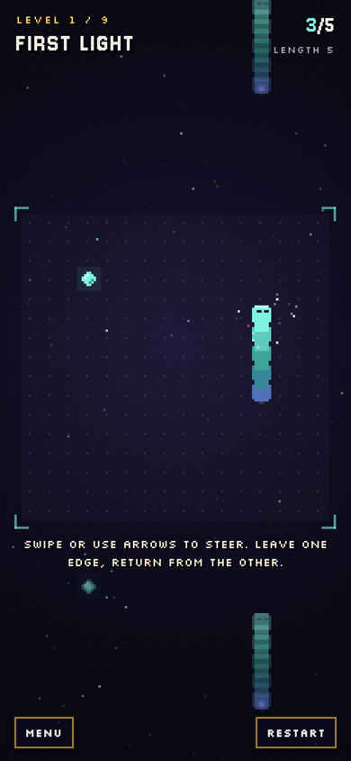
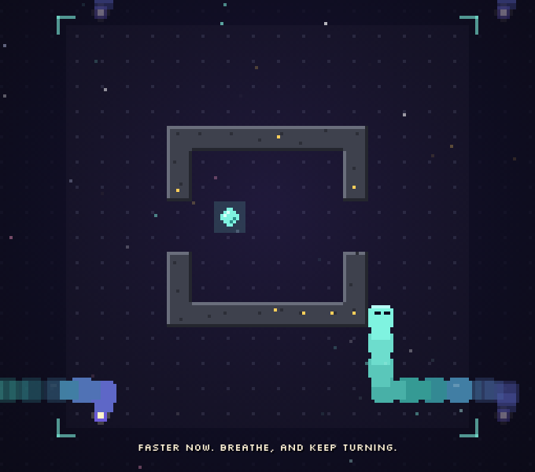

# OUROBOROS

A fast, chill pixel snake in a world without edges.
Leave the screen on one side and you slide back in from the other. Eat the bits, grow longer, don't bite yourself.
Nine short levels, about ten minutes from start to finish. The last one is different.

**[▶ Play in your browser](https://krupakarsb.github.io/bitpillars/ouroboros/)**: works on phones (swipe) and desktop (arrow keys / WASD).

<p>
  
  
  
</p>

## How to play

| Thing | What it does |
|---|---|
| Teal bit | +1 length. Eat enough to clear the level |
| Gold bit | +3 length. Appears for a moment, then fades |
| Pink bit | −2 length. Your way out of a tight spot |
| Wall | Solid. The world still wraps around it |

Each level gets a little faster with every bit you eat. Turns are buffered, so a quick double swipe makes a clean U-turn.

**Controls:** swipe (you can keep your finger down and swipe again) or arrow keys / WASD · `R` restart · `Esc` / `P` pause

## Modes

- **Story:** 9 levels: open space, pillars, corridors, gold, pink, drifting bits, a maze, a rush… and an ending.
- **Endless:** unlocked after the story. Random walls, every open cell guaranteed reachable. How long can the loop grow?

## How it works

- **Engine** (`src/engine.js`): pure logic with no DOM, shared by the browser and Node. A 16×16 toroidal grid, a fixed-step simulation, a two-deep turn buffer and seeded randomness (mulberry32). Moving into the cell your tail is leaving is safe, as in classic snake.
- **Rendering:** a low-resolution canvas scaled up with integer nearest-neighbour scaling. The snake slides smoothly between cells, and the wrapped world is drawn as fading copies around the arena, so you can see where you will come back in.
- **Audio:** every sound and the soft generative soundtrack are synthesized with the Web Audio API. No asset files. Eating bits in quick succession climbs a pentatonic scale.
- **Tests:** a BFS bot clears every level (`test/bot.js`), and a fuzzer runs about 240,000 random steps across all levels, checking invariants and that the last level can't be survived forever (`test/fuzz.js`).
- No frameworks and no build dependencies: the game ships as one self-contained `index.html`, saved progress lives in `localStorage`.

## Project layout

```
index.html                built game (served at /bitpillars/ouroboros/)
src/engine.js             simulation, levels, endless generator
src/game.template.html    rendering, UI, audio, input
tools/build.py            inlines the engine into the template -> index.html
test/bot.js               BFS bot plays every level
test/fuzz.js              random-input fuzzer and invariant checks
docs/                     screenshots and the 16:10 thumbnail used on the BitPillars page
```

## Build and test

```
python3 tools/build.py
node test/bot.js
node test/fuzz.js
```

Part of [BitPillars](https://krupakarsb.github.io/bitpillars/). MIT licensed.
