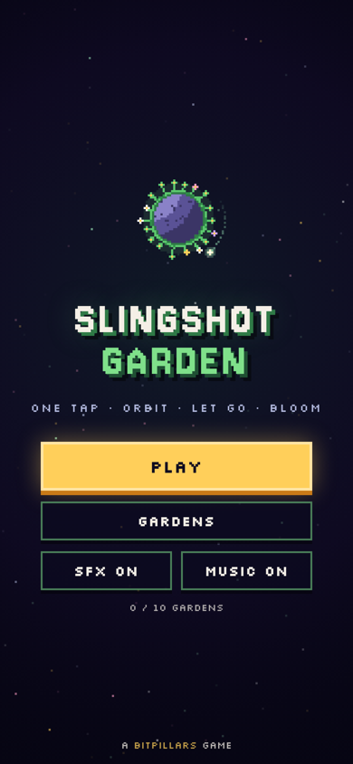
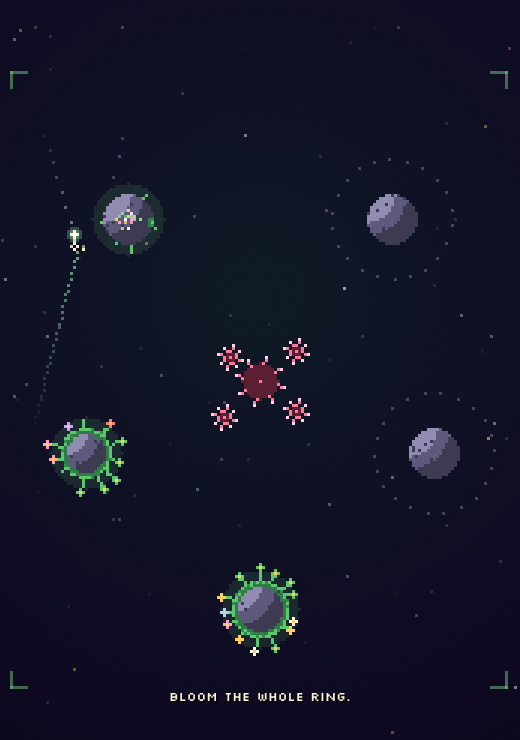

# SLINGSHOT GARDEN

A one-tap pixel game about orbits and letting go.
You circle a tiny planet. Tap, and you fly off in a straight line until the next planet catches you. Every planet you touch bursts into a little garden.
Ten gardens, about ten minutes, very chill.

**[▶ Play in your browser](https://krupakarsb.github.io/bitpillars/slingshot/)**: tap anywhere on a phone, or press Space on a desktop.

<p>
  
  
</p>

## How to play

| Thing | What it does |
|---|---|
| Tap | Let go of the planet you're orbiting. You fly straight along the dotted guide |
| Planet | Catches you when you fly through its ring, and blooms the first time you land |
| Small planet | Spins you around faster |
| Thorns | Send you back to the last planet you were on |
| Empty space | Fly off the edge and you drift back to your last planet |

Bloom every planet to finish a garden. There's no timer and no game over. Try to use as few taps as you can.

**Controls:** tap / click, or Space / Enter / Up · `R` restart the garden · `Esc` pause.

## How it works

- **Engine** (`src/engine.js`): pure logic with no DOM, shared by the browser and Node. Fixed 60 Hz steps. You fly in a straight line at a constant speed. You're caught by the nearest ring you enter, and your orbit direction comes from the direction you were flying.
- **Solver** (`test/solver.js`): builds the full graph of "caught in orbit" states by letting go on every frame of every orbit. It proves that every planet can be reached and that no state can trap you, so you can always finish. It also finds the fewest taps for each garden.
- **Bot** (`test/bot.js`): plays every garden with that fewest number of taps through the real engine and saves the taps. The browser test replays them in the built game.
- **Fuzzer** (`test/fuzz.js`): about 1.5 million frames of random tapping, checking that orbits, speed and blooms always stay consistent.
- **Audio:** every sound and the ambient soundtrack are synthesized with the Web Audio API. No asset files.
- The game ships as one self-contained `index.html`. Progress is saved in `localStorage`.

## Build and test

```
python3 tools/build.py
node test/check.js
node test/bot.js
node test/fuzz.js
```

Part of [BitPillars](https://krupakarsb.github.io/bitpillars/). MIT licensed.
